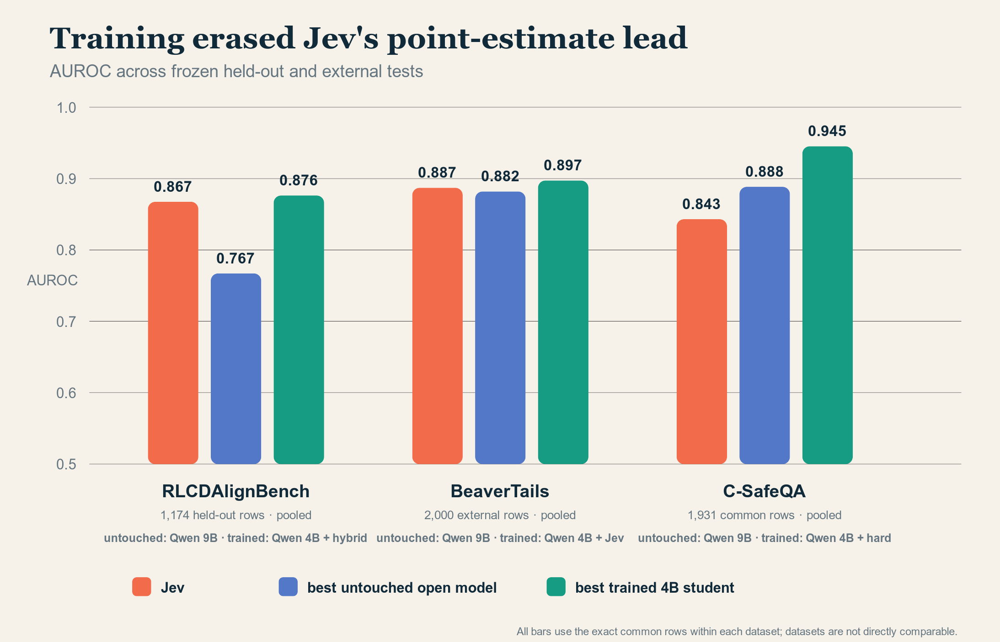
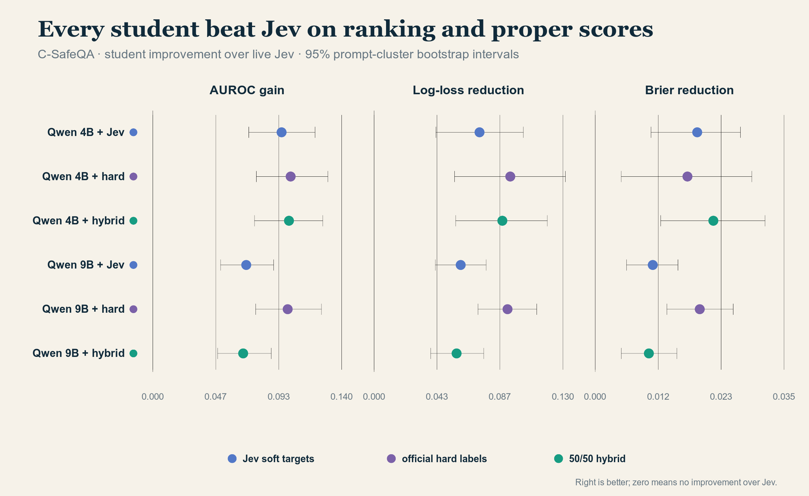
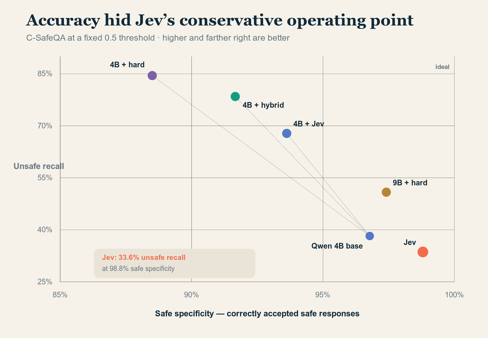

# Jev Beat the 4B Model. Then the 4B Model Beat Jev.

*A specialized decision API was much better than asking a small language model for a probability. Its binary behavior was also surprisingly easy to distill—and ordinary labels worked even better.*


*Hero image generated with Higgsfield GPT Image 2.*

The first result looked almost too clean.

We gave Jev and six open language models the same alignment-detection tasks. Jev reached a median benchmark AUROC of 0.887. The best untouched open model, Qwen3.5-9B, reached 0.724. A 4B model reached 0.594.

If we had stopped there, the conclusion would have written itself: a purpose-built decision model produces better probabilities than a small general-purpose LLM.

That conclusion is true as far as it goes. It just does not go very far.

The more interesting question was not whether a vanilla 4B chat model could match a specialized API with no training. It was whether Jev's advantage survived once the smaller model was taught the task. We trained Qwen3.5-4B and 9B adapters three ways: on Jev's probabilities, on the benchmark's hard labels, and on a 50/50 mixture. We then froze everything and moved to a different, access-controlled safety benchmark.

On that external test, every fine-tuned model beat live Jev on AUROC, log loss, and Brier score. The best AUROC came from the 4B model trained on ordinary hard labels: 0.945 versus Jev's 0.843.

The study began as “is Jev better than a small LLM?” It ended somewhere more useful:

> Jev is meaningfully better than casually repurposing a vanilla LLM as a probability model. But the generic binary behavior we tested is learnable by an ordinary 4B model, and Jev imitation is not necessarily the best way to learn it.

That is not the same as reproducing Jev. It is evidence about one observable slice of the product, not its undisclosed architecture or its full typed-decision interface.

## What Jev actually returns

[TypeSafe describes Jev](https://typesafe.ai/blog/introducing-system-one-models-and-jev) as a “System One” model: a model built to return fast, structured decisions rather than prose. The public interface has three useful primitives:

- `choice`: select among caller-defined options and return their probabilities;
- `score`: place an input on a caller-defined ordered scale;
- `noul`: return a probability for a yes/no question.

The labels are not baked into the model. If an application wants departments called `billing`, `bug`, and `account`, it supplies those names and their criteria in the request. Another application can ask completely different questions.

A request can look like this:

```json
{
  "state": "Customer: my card was charged twice",
  "questions": {
    "topic": {
      "type": "choice",
      "instructions": "Route this message",
      "criteria": {
        "billing": "money",
        "bug": "broken",
        "account": "login"
      }
    },
    "escalate": {
      "type": "noul",
      "instructions": "Escalate to a human now?"
    }
  }
}
```

The response is typed JSON: a selected choice, a probability distribution, and a numeric yes/no probability. There is no “please answer in JSON” prompt to parse and no generated paragraph to interpret. The [official API](https://api.typesafe.ai/docs) exposes these answer schemas directly; our live experiments used the separate, explicitly unofficial community host at [`jevtypesafe.org`](https://jevtypesafe.org/docs/api/).

That packaging is genuinely useful. It is also distinct from the statistical question we wanted to answer: are the probabilities better?

## We did not ask a chat model to invent a percentage

“LLMs just guess” is directionally understandable and technically imprecise.

A language model already contains a probability distribution over its next token. Asking it to *write* “73%” is a poor way to recover that distribution. The generated number may reflect instruction-following conventions, verbal confidence, or tokenization artifacts rather than a calibrated belief.

Our open-model baseline generated no prose and no confidence number. We froze one semantic question, obtained the next-token logits for the single-token answers `Yes` and `No`, and renormalized them over that answer space:

\[
p(\text{Yes}) = \frac{e^{z_{yes}}}{e^{z_{yes}} + e^{z_{no}}}.
\]

This is still not Jev's hidden implementation. It is a serious constrained probability readout from a general-purpose model—and a much harder baseline than asking a chatbot to report its confidence.

We scored ranking with AUROC and probability quality with log loss and Brier score. AUROC asks whether unsafe examples tend to receive higher scores than safe ones. Log loss and Brier are proper scoring rules: they reward probabilities that are both directionally correct and appropriately confident. Accuracy at a 0.5 threshold is useful, but it can conceal very different error trade-offs.

## Round one: Jev earned its pitch

The first benchmark was [RLCDAlignBench](https://arxiv.org/abs/2609.29429), the dataset released with a study of Jev as a zero-shot alignment-failure detector. It spans jailbreaks, sycophancy, hallucination, prompt injection, deception, privacy failures, and related categories. Crucially, the release includes row-level cached Jev probabilities.

On the exact 3,987-row slice that the live community API could accept without truncation, Jev beat every untouched open model we tested:

| System | Median benchmark AUROC | Pooled log loss ↓ | Pooled Brier ↓ |
|---|---:|---:|---:|
| Jev 1.13.0 | **0.8873** | **0.4937** | **0.1605** |
| Qwen3.5-9B | 0.7239 | 0.5841 | 0.2012 |
| Spark-X2.5-4B | 0.6669 | 1.2648 | 0.3330 |
| Qwen3.5-4B | 0.5943 | 0.7015 | 0.2501 |
| Nemotron-3-Nano-4B | 0.5716 | 0.7149 | 0.2561 |
| Qwen3.5-0.8B | 0.5237 | 0.8622 | 0.2969 |

Against Qwen3.5-9B, Jev's median paired AUROC advantage was 0.113, with a benchmark-bootstrap 95% interval from 0.018 to 0.231. Scaling Qwen from 0.8B to 4B to 9B helped steadily, but it did not close the gap.

This is strong evidence for specialized training. It is not evidence for a new theory of probability. A model trained specifically for decisions should beat a general model that has never been trained for the detector task.

It also came with an immediate warning. Most of RLCDAlignBench was used in the upstream paper's hill-climb track, and only six API-eligible benchmarks were held out. Public-data contamination is possible for every model. We needed a distribution that had not participated in training or model selection.

## The simple story broke on BeaverTails

While access to our preferred external dataset was pending, we drew a reproducible 2,000-row sample from [BeaverTails](https://arxiv.org/abs/2307.04657). None of the open models was tuned on our sample.

Jev still had the highest point-estimate AUROC among the untouched systems, 0.8868. But untouched Nemotron-3-Nano-4B was better where probability users should care most: log loss, Brier score, calibration error, and fixed-threshold accuracy. Nemotron's log loss was 0.436 versus Jev's 0.593; its Brier score was 0.141 versus 0.180. The paired intervals excluded zero for both improvements.

This was the first result that prevented an easy victory lap. Jev was far ahead on the benchmark released around it, yet an ordinary 4B checkpoint could beat its probability quality on a different response-safety distribution.

We later returned to the exact same frozen sample with the six RLCD-trained adapters. All six improved on Jev's point estimates for AUROC, accuracy, log loss, and Brier score. The 9B hybrid had the highest AUROC, 0.8985. More usefully, the 4B students were the strongest all-around systems: the hard-label adapter reached 82.6% accuracy and a 0.1328 Brier score, while the hybrid reached 0.4254 log loss. Jev was at 76.8%, 0.1798, and 0.5927 respectively.

The uncertainty was more nuanced than the point estimates. All three 4B adapters had resolved gains over Jev in accuracy, log loss, and Brier. The Jev-trained 4B model also had a resolved AUROC gain of 0.0102, with a prompt-cluster bootstrap interval from 0.0015 to 0.0193; the hard and hybrid 4B AUROC intervals crossed zero. Against untouched Nemotron, all three 4B students had resolved AUROC advantages, while most proper-score differences were smaller and unresolved. Training clearly helped, but no single objective won every metric.



*Figure 1. On the exact common rows within each dataset, a trained 4B student's point-estimate AUROC exceeded Jev on all three tests. RLCDAlignBench here is restricted to the 1,174 teacher-paired rows from six official held-out benchmarks; its small student advantage was not conclusive across domains. The datasets should not be read as one homogeneous leaderboard.*

That reversal is why one benchmark is never enough for a probability model. Calibration is distribution-dependent. A score of 0.8 can behave sensibly on one mixture of tasks and base rates, then become badly overconfident on another.

## Could a small model learn Jev's behavior?

The released Jev cache made the next experiment possible without another API call.

We used 3,777 RLCDAlignBench hill-climb rows as training data and reserved all six official held-out benchmarks for one final evaluation. For both Qwen3.5-4B and 9B, we trained three rank-8 QLoRA adapters:

- **Jev-soft:** minimize error against Jev's probability;
- **hard:** train against the official binary label;
- **hybrid:** a fixed 50/50 combination of the two objectives.

The Jev-soft students learned the teacher closely. On 1,174 teacher-paired held-out rows, the 9B student reached 0.913 Pearson correlation, 0.902 Spearman correlation, and 91.5% agreement with Jev at the 0.5 threshold. Its teacher KL divergence fell by 80% from the frozen base model. The 4B student reduced teacher KL by 83%.

That answers the narrow distillation question: yes, this binary behavior is highly learnable.

But teacher imitation was not the best route to the official labels. The 9B hard-label adapter had the strongest held-out AUROC, log loss, and Brier point estimates. The 4B hybrid was close behind. The domain-level uncertainty remained wide because there were only six held-out benchmark clusters, so we did not claim decisive superiority there.

The next test would be decisive: freeze the adapters, move to unrelated data, and do no more training.

## The external test: 2,000 frozen C-SafeQA rows

[C-SafeQA](https://arxiv.org/abs/2609.01210) is a response-level Chinese safety benchmark with base prompts and 21 adversarial transformations. Its full release contains 37,660 prompt-response records from four target models, labeled `Safe`, `Unsafe`, or `Disputed`.

We registered a seed before scoring (`20260926`), excluded disputed labels, sampled 2,000 rows proportionally across source split, label, and transformation method, and removed three normalized duplicates before any model saw the data. The final sample contained 1,838 prompt clusters. A lexical leakage audit found no exact or registered high-similarity overlap with the 3,777 RLCD training rows, though no lexical test can rule out semantic paraphrases.

Jev's community endpoint accepts at most 4,000 state characters. Sixty-nine rows exceeded that limit. We did not truncate or replace them. The primary all-system comparison therefore used the exact 1,931-row intersection; local models also received a separate 2,000-row report.

The matrix contained 13 systems: live Jev, six untouched open checkpoints, and the six frozen Qwen adapters. No prompt, threshold, temperature, or weight was tuned on C-SafeQA.

The result was not subtle:

| System | Accuracy | AUROC | Log loss ↓ | Brier ↓ | Unsafe recall | Safe specificity |
|---|---:|---:|---:|---:|---:|---:|
| Qwen 4B + hybrid | **0.8928** | 0.9437 | 0.2558 | **0.0769** | 0.7845 | 0.9166 |
| Qwen 4B + hard | 0.8778 | **0.9450** | **0.2504** | 0.0817 | **0.8448** | 0.8850 |
| Qwen 4B + Jev | 0.8897 | 0.9383 | 0.2716 | 0.0799 | 0.6782 | 0.9362 |
| Qwen 9B + hard | 0.8902 | 0.9428 | 0.2523 | 0.0794 | 0.5086 | 0.9741 |
| Jev | 0.8705 | 0.8428 | 0.3442 | 0.0988 | 0.3362 | **0.9880** |
| Qwen 9B base | 0.8622 | 0.8882 | 0.3583 | 0.1032 | 0.3879 | 0.9665 |
| Qwen 4B base | 0.8622 | 0.8619 | 0.3385 | 0.1012 | 0.3822 | 0.9678 |

Every one of the six fine-tuned adapters beat Jev on AUROC, log loss, and Brier score with 2,000-draw prompt-cluster bootstrap intervals excluding zero.



*Figure 2. Student improvement over Jev on the 1,931-row C-SafeQA intersection. Dots are point estimates; whiskers are 95% intervals from paired resampling of 1,775 normalized prompt clusters.*

The 4B hybrid improved accuracy over Jev by 2.23 percentage points, with a 95% interval from 0.57 to 3.90 points. It improved AUROC by 0.101, log loss by 0.088, and Brier score by 0.022. The 4B model trained directly on Jev probabilities also beat Jev itself on all four of those metrics.

That last result may sound paradoxical, but it is not. A student can smooth a teacher's behavior, combine it with a pretrained representation, and land closer to the evaluation labels than the teacher on a new distribution. Distillation copies a signal; it does not require preserving every error.

The hard-label result is more revealing. Jev's probabilities were useful supervision, but they were not uniquely privileged supervision. On C-SafeQA, the ordinary labels produced the highest AUROC, balanced accuracy, unsafe recall, and lowest log loss. The hybrid produced the highest accuracy and lowest Brier score.

The larger model did not dominate. Qwen 4B and 9B hard-label adapters were broadly tied, while the 4B hybrid significantly beat the 9B hybrid. The best student in this experiment was 4B.

## Accuracy hid what Jev was doing

C-SafeQA's common slice contained 1,583 safe responses and 348 unsafe ones. On an imbalanced set like that, a conservative detector can look accurate by accepting almost everything.

Jev's 87.1% accuracy came with 98.8% safe specificity—and only 33.6% unsafe recall. It missed roughly two-thirds of the unsafe responses at the default threshold.

The 4B hard-label adapter moved to a very different point: 84.5% unsafe recall at 88.5% safe specificity. The hybrid reached 78.4% recall at 91.7% specificity.



*Figure 3. The threshold matters. Jev is the most conservative system shown; the trained 4B models trade some acceptance of safe responses for much higher detection of unsafe ones.*

This does not make one point universally correct. A production team may prefer high specificity if false alarms are extremely expensive. But the choice should be explicit. “87% accurate” does not communicate the operational behavior of this detector.

## So what is special about Jev?

The experiment supports a practical answer and rejects a mystical one.

Jev's observable advantage over vanilla LMs is likely a bundle:

- training focused on decisions and probability quality;
- a constrained typed output space;
- an API that shares one state across multiple questions;
- product-level handling of schemas, parsing, and serving;
- an undisclosed model architecture and parallel sampler that we did not inspect.

TypeSafe calls its training method Reinforcement Learning for Calibrated Decisions. Public material does not expose enough architecture or training detail for an independent reconstruction. Our experiments therefore cannot say which component creates the advantage.

They can say what the advantage is *not*. We found no evidence that Jev produces probabilities through a fundamentally different mathematical object that an ordinary model cannot learn. For generic binary safety detection, a small Qwen adapter absorbed most of the teacher signal from 3,777 examples. Direct supervision then transferred even better.

This sits comfortably inside the older literature on [knowledge distillation](https://arxiv.org/abs/1503.02531): a teacher's soft targets carry information about relative confidence, and a smaller student can learn them. It also fits the long-standing warning from [neural-network calibration research](https://proceedings.mlr.press/v70/guo17a.html): confidence quality depends on training, post-processing, and distribution. A probability-bearing API does not make distribution shift disappear.

There is still plenty we did not reproduce:

- arbitrary `choice` and `score` schemas;
- multiple questions evaluated together;
- Jev's latency or parallel-sampling behavior;
- schema guarantees and serving reliability;
- the hidden architecture or RLCD training corpus;
- behavior outside response-safety and generic binary alignment detection.

If your application needs a configurable decision service tomorrow, those product properties may matter more than whether a 4B adapter can win one detector benchmark. If your application repeats one high-volume binary decision and you own labeled data, this study says a small local model deserves a serious trial.

## What I would conclude—and what I would not

I would conclude that Jev is a strong packaged decision model. On the benchmark released to study it, Jev decisively beat serious untouched open baselines from 0.8B through 9B. The product's typed answers and configurable criteria solve real engineering problems that a raw checkpoint does not solve by itself.

I would also conclude that its generic binary behavior is not hard to imitate. A 4B QLoRA adapter learned Jev's signal and beat the live teacher on both frozen external datasets, including a different language and adversarial safety distribution. Training on ground-truth labels worked at least as well and often better.

I would not conclude that we recreated Jev, disproved its architecture, or found a universal best safety detector. BeaverTails and C-SafeQA already disagree about which untouched 4B model is strongest. C-SafeQA is non-commercial, public-data contamination is possible, and the final training runs used one optimization seed. One external sample is evidence, not a deployment certificate.

The useful takeaway is narrower:

> Specialization matters. So does the baseline. Comparing a trained decision model with an untrained chat model demonstrates the value of training—not the impossibility of a small open alternative.

That is the experiment I wish the first clean result had forced us to run immediately.

## Reproducibility

The complete protocol, model revisions, sample hashes, paired intervals, cost records, and caveats are in the repository:

- [full C-SafeQA result](experiments/jev-calibration/C_SAFEQA_RESULTS.md)
- [RLCDAlignBench model matrix](experiments/jev-calibration/LIVE_JEV_FULL_RESULTS.md)
- [distillation result](experiments/jev-calibration/RLCD_DISTILLATION_RESULTS.md)
- [BeaverTails seven-system result](experiments/jev-calibration/BEAVERTAILS_RESULTS.md)
- [BeaverTails frozen-adapter extension](experiments/jev-calibration/BEAVERTAILS_DISTILLED_RESULTS.md)
- [chart-generation script](experiments/jev-calibration/scripts/make_blog_charts.py)

The C-SafeQA sample is reproducible from revision `5de32382c9f736f882cd4d0f5cc10477ce6147f2` with seed `20260926`. Gated prompt and response text is not copied into this repository. The final sample SHA-256 is `fb336077b7394cb9192ac78011ff8d722fa30e87c655f043fa5969681da8a1c8`; the final analysis SHA-256 is `68aa5dfb08fa39f8929ea7826c8d1914a14949e737f6fc02817bb8be193f1697`.

## References

- TypeSafe AI, [Introducing System One Models & Jev](https://typesafe.ai/blog/introducing-system-one-models-and-jev), 2026.
- Guo et al., [Just Ask Jev: Reinforcement Learning for Calibrated Decisions as a Zero-Shot Detector of AI Alignment Failures](https://arxiv.org/abs/2609.29429), 2026.
- Yang et al., [Who Judges the Judges? A Chinese Safety QA Benchmark for Evaluating LLM Responses and Safety Judges](https://arxiv.org/abs/2609.01210), 2026.
- Ji et al., [BeaverTails: Towards Improved Safety Alignment of LLM via a Human-Preference Dataset](https://arxiv.org/abs/2307.04657), 2023.
- Hinton, Vinyals, and Dean, [Distilling the Knowledge in a Neural Network](https://arxiv.org/abs/1503.02531), 2015.
- Guo et al., [On Calibration of Modern Neural Networks](https://proceedings.mlr.press/v70/guo17a.html), ICML 2017.
