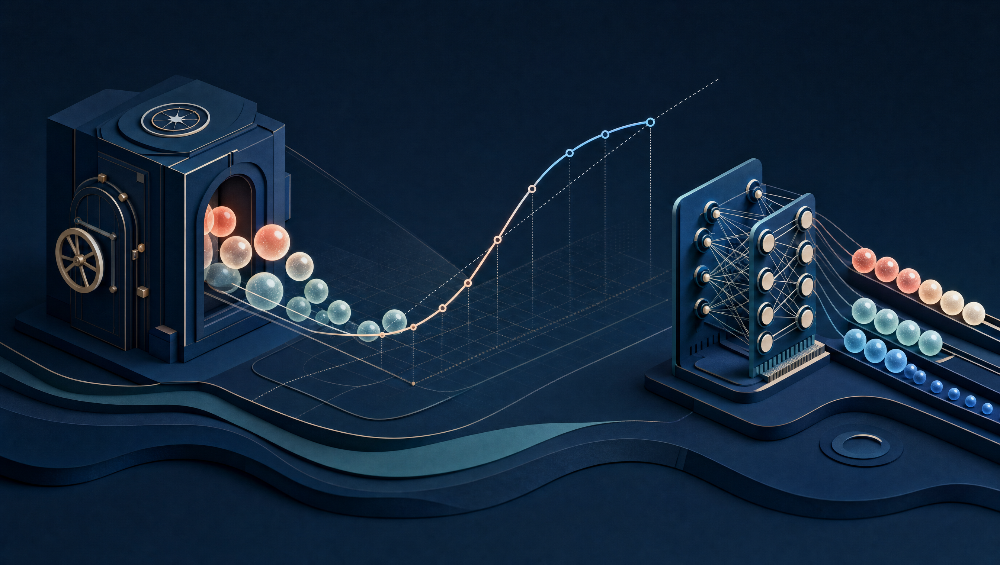

# Jev vs. Small LLMs

This repository contains the article, experiment code, frozen aggregate results,
and reproducible figures for a comparison of Jev with untouched and fine-tuned
small language models.

[Read the full article: *Jev Beat the 4B Model. Then the 4B Model Beat Jev.*](ARTICLE.md)



## The result in one table

| Evaluation | Jev | Strongest reported trained 4B result |
|---|---:|---:|
| RLCDAlignBench held-out AUROC | 0.867 | 0.876, hybrid |
| BeaverTails AUROC | 0.887 | 0.897, Jev-soft |
| C-SafeQA AUROC | 0.843 | 0.945, hard labels |

Jev decisively beat untouched 0.8B–9B models on RLCDAlignBench. After split-safe
QLoRA training on 3,777 released hill-climb rows, however, a 4B model learned
the tested binary behavior and transferred better on the two frozen external
evaluations. Direct hard-label or hybrid supervision often outperformed pure
teacher imitation.

This is evidence about generic binary safety/alignment detection. It does not
reproduce Jev's architecture, arbitrary `choice` or `score` schemas,
multi-question serving, latency, or production guarantees.

## Repository layout

- `ARTICLE.md` — long-form account of the full study.
- `articles/figures/` — hero image and deterministic data figures in PNG/SVG.
- `experiments/jev-calibration/configs/` — frozen dataset, model, and training
  configurations, including model revisions and sampling seeds.
- `experiments/jev-calibration/scripts/` — data preparation, constrained
  Yes/No scoring, Jev evaluation, QLoRA training, analysis, and chart code.
- `experiments/jev-calibration/tests/` — 55 unit tests covering the protocol,
  metrics, sampling, overlap audit, live-response validation, and analyses.
- `experiments/jev-calibration/results/` — aggregate machine-readable outputs
  used by the charts. No gated prompt or response text is included.
- `experiments/jev-calibration/*_RESULTS.md` — full result tables, uncertainty,
  hashes, costs, deviations, and caveats.
- `THIRD_PARTY_NOTICES.md` — provenance for the minimal MIT-licensed upstream
  code fixture used by one protocol test.

## Reproduce the figures

The chart generator uses only Python's standard library and the frozen aggregate
JSON files committed here:

```bash
python3 experiments/jev-calibration/scripts/make_blog_charts.py
```

It rewrites the three measured-data SVGs under `articles/figures/`. The checked-in
PNG copies are provided for renderers that do not display SVG reliably.

## Run the tests

```bash
python3 -m unittest discover -s experiments/jev-calibration/tests -v
```

Most protocol and analysis tests use the Python standard library; the complete
suite also imports PyTorch, Transformers, Hugging Face Hub, and PyArrow through
the model and data helpers. Training additionally requires PEFT, bitsandbytes,
and Accelerate. CUDA/package combinations differ across the pinned model
families, so the result reports should be consulted before reproducing GPU runs.

## Reproduce the evaluations

The frozen protocol is encoded in the JSON configs rather than in shell scripts
containing machine-specific paths. A full rerun requires:

1. accepting the applicable Hugging Face dataset and model terms;
2. authenticating with Hugging Face for gated RLCDAlignBench and C-SafeQA;
3. preparing the datasets with the pinned commits and seeds in `configs/`;
4. running the frozen open-model and distillation scripts on CUDA hardware; and
5. supplying your own Jev credential only if you choose to repeat live calls.

The released RLCDAlignBench Jev cache is sufficient for the no-key teacher
comparison and distillation study. Live API calls are not required to regenerate
the figures from the included aggregate results.

## Public-data boundary

This repository intentionally excludes:

- `.env` files, credentials, bearer tokens, and API keys;
- gated C-SafeQA and RLCDAlignBench prompt/response text;
- row-level model predictions and raw Jev responses;
- model weights, adapters, caches, logs, process files, and machine paths; and
- the upstream dataset repositories themselves.

The C-SafeQA sample can be reconstructed from commit
`5de32382c9f736f882cd4d0f5cc10477ce6147f2` with seed `20260926`; its final
sample SHA-256 is
`fb336077b7394cb9192ac78011ff8d722fa30e87c655f043fa5969681da8a1c8`.
Third-party dataset and model licenses continue to apply. C-SafeQA is
non-commercial (CC BY-NC 4.0), and no C-SafeQA content is redistributed here.

## Main limitations

- Public benchmark contamination remains possible.
- The final adapters used one deterministic optimization seed.
- RLCDAlignBench uncertainty is coarse because the official held-out set has
  only six benchmark clusters.
- BeaverTails and C-SafeQA represent different languages, base rates, and
  safety distributions.
- Fixed-threshold accuracy can conceal large recall/specificity differences;
  AUROC and proper scores should be read alongside it.

Every claim in the article is backed by a linked result report or frozen
aggregate artifact in this repository.
